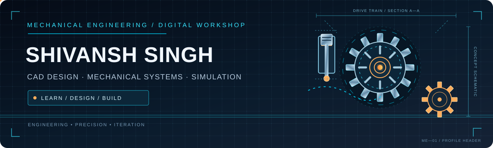

# Hi, I'm Shivansh Singh 👋

### Mechanical Engineering Student | CAD & Design | Learning Simulation

Building my skills by turning engineering concepts into practical projects.

---

## ⚙️ About Me

- 🎓 B.Tech Mechanical Engineering student at the University of Lucknow.
- 🧰 Exploring CAD, mechanical design, and engineering simulation.
- 📐 Completed a six-week online AutoCAD course with Zylphon.
- 🚀 Currently building technical projects and strengthening my engineering toolkit.
- 📫 Connect with me on [LinkedIn](https://www.linkedin.com/in/shivansh-singh-a24973335/).

## 🛠️ Tools & Technologies

  
  
  
  
  

> Skill badges show areas of interest and learning; they are not claims of certification or expert proficiency.

## 🚀 Featured Projects

*If a project card does not load, check the repository name and capitalization in the URL.*

## 📊 GitHub Dashboard

  
  

  

## 🐍 Contribution Snake

The snake graphic is generated automatically by GitHub Actions. Once the workflow has run successfully, it should appear below.

  <picture>
    <source media="(prefers-color-scheme: dark)" srcset="https://raw.githubusercontent.com/shivanshsinghlu24/shivanshsinghlu24/output/github-contribution-grid-snake-dark.svg" />
    <source media="(prefers-color-scheme: light)" srcset="https://raw.githubusercontent.com/shivanshsinghlu24/shivanshsinghlu24/output/github-contribution-grid-snake.svg" />
    
  </picture>

## 🧊 3D Contribution Calendar

This image is generated by a separate scheduled workflow. It may take one successful workflow run before it becomes visible.

  

## 🎯 Current Focus

- Improving CAD drawing and modelling skills.
- Learning the foundations of mechanical design and simulation.
- Publishing clear, documented beginner-friendly projects.
- Preparing for GATE Mechanical Engineering.

---

**Thanks for visiting!**  
*Design • Analyse • Improve*

